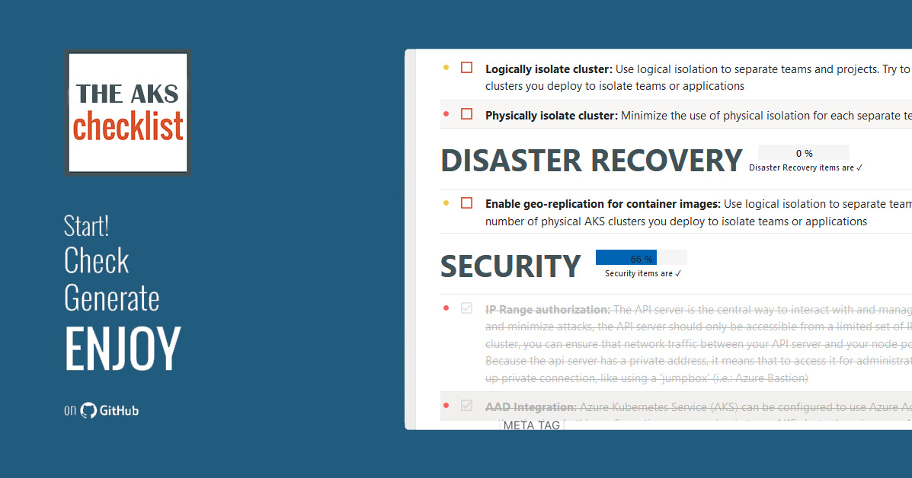

# The Azure Kubernetes Service Checklist

  

The deployed version can be found here: [https://aka.ms/the-aks-checklist](https://aka.ms/the-aks-checklist)


The AKS Checklist is a (tentatively) exhaustive list of all elements you need to think of when preparing a cluster for production. It is based on all common best practices agreed around Kubernetes or documented [here](https://learn.microsoft.com/azure/aks/best-practices).

Another good reading in another format is the [AKS baseline reference architecture](https://github.com/mspnp/aks-secure-baseline)

## Scope and currency

The English source in `data/en/items/*.json` drives the website, Azure Review
Checklists export and [downloadable PDF](src/web/docs/AKS-Checklist.pdf).
The content was reviewed against current Microsoft Learn and Kubernetes
documentation on **4 November 2026**. Each check links to its supporting sources.

This is an architecture review aid, not a certification or a guarantee of
production readiness. Assess applicability, document exceptions and evidence,
and verify regional availability, feature support, retirement notices and
pricing before implementing a recommendation. Preview features require an
explicit risk decision; they are not unconditional production defaults.

### Review outcomes, applicability and consolidation

The checklist scores review outcomes, not adoption of particular products.
GitOps, Azure Backup, ephemeral OS disks and specialist compute/network options
are implementation choices that must fit the workload. Conditional controls show
their applicability criteria; reviewers can mark them **Not applicable** without
claiming they are **Fulfilled**. Not-applicable controls are excluded from
completion denominators. Naming conventions and tool catalogs are kept in an
unscored reference appendix and are omitted from the Azure Review Checklists
export.

Repeated checks have one canonical home. Related controls link across sections,
while distinct stages such as build scanning, continuous reassessment, admission
enforcement and runtime detection remain separate. Consolidated controls retain
the canonical GUID and list retired GUIDs in `supersedes`. The website migrates
legacy positional progress using the frozen `data/en/legacy-index.json` map,
then persists stable GUID identities. A merged control is automatically fulfilled
only when all its predecessor checks were fulfilled; partial or conflicting
answers require review. Original progress is backed up before migration.

Progress is stored locally in the browser under `aks-checklist:state:v2`.
The original migration backup is retained under `aks-checklist:legacy-backup:v1`.
To inspect raw saved data without changing it, run `AksChecklistState.recovery()`
in the browser console. **Start new checklist** resets only checklist answers and
filters, preserves project metadata and unrelated storage, and first creates a
timestamped `aks-checklist:reset-backup:` recovery copy. Backups are never replayed
automatically after reset. Unreadable saved data produces a visible warning and
session-only answers rather than silently overwriting the original.

The responsive review workspace uses the field guide's deep navy/blue palette
and includes a sun/moon button for **light and dark mode**.
It follows the system appearance until you choose a theme, then saves
that choice separately under `aks-checklist:theme:v1`. Resetting checklist
answers does not reset appearance. Storage restrictions show a visible warning;
the toggle still works for the current tab. Printed reports use a light,
ink-friendly layout regardless of the screen theme.

Configuration flags alone are not proof of effective policy, filtered egress or
application resilience. Checks that require runtime evidence no longer export
misleading compliance queries. Explicit operational checks cover application TLS
renewal and expiry, admission-webhook resilience, controlled fault injection under
load, and parallel-cluster migration where in-place upgrades cannot meet risk
requirements.

The modernization covers lifecycle and retirement migration, networking and
Gateway API, identity and policy, workload supply chains, observability,
autoscaling and costs, storage, backup/restore and multicluster resilience.
Version-specific dates belong in lifecycle checks, not hard-coded recommendations
to deploy a particular Kubernetes minor version.

### Important lifecycle findings

| Area | Finding and required review |
| --- | --- |
| Node operating systems | Azure Linux 2.0 security updates ended on 30 November 2025; image removal began on 31 October 2026. Migrate remaining pools to a supported OS and test node replacement. |
| Windows | Windows Server 2019 support ended on 1 March 2026; Windows Network Policy Manager support ended on 30 September 2026. Validate the replacement OS and policy engine together, including gaps in the current support matrix. |
| Ingress | Upstream ingress-nginx maintenance ended in March 2026. Microsoft's application-routing NGINX security patch support runs through November 2026; assess a supported Gateway API implementation and test migration. |
| Networking and identity | Basic Load Balancer and the Pod Identity managed add-on are no longer supported. Use Standard Load Balancer and Microsoft Entra Workload ID. Plan kubenet migration before its 31 March 2028 retirement. |
| Logging | ContainerLog support retired on 30 September 2026. Migrate queries, alerts, workbooks and exports to ContainerLogV2, not just the collector configuration. |
| Recovery | Zone redundancy and geo-replication are not backups. Validate supported volume types, restore consistency, recovery dependencies and achieved RPO/RTO. |

Supporting retirement notices and migration documentation are linked in the
corresponding checklist entries. Removed recommendations are retained as
updated migration checks where that preserves a useful review control and its
GUID. Conflicting or incomplete Windows support documentation is explicitly
called out rather than resolved by assuming support.

## Validate and generate locally

Use Python 3.10+, Node.js for browser-state and link-tracking tests, the .NET 10 SDK, and an installed Chrome, Chromium or Edge
browser. The Python publishing scripts use only the standard library. NuGet
restore uses the Microsoft-protected feed in `NuGet.Config`.
The generator targets [.NET 10 LTS](https://dotnet.microsoft.com/en-us/platform/support/policy/dotnet-core)
rather than .NET 8, whose support ends on 10 November 2026.

```powershell
python data\scripts\checklist.py
python -m unittest discover -s data\scripts -p "test_*.py"
node data\scripts\test_link_tracking.js
node data\scripts\test_checklist_state.js
node data\scripts\test_theme.js
python data\scripts\transform_to_ft.py
python data\scripts\generate_offline.py --date 2026-11-04 --pdf src\web\docs\AKS-Checklist.pdf
dotnet run --project src\generator -- -f data\tooling\html-generator\template.html -p data\en\items -o src\web\index.html
node data\scripts\test_checklist_state.js src\web\index.html
python data\scripts\check_links.py
```

Omit `--date` to use today's date; use `--browser` if the renderer is not
discovered automatically. Markdown and self-contained printable HTML are written
to `output/`; the PDF includes clickable references and a contents list.
Generate all three styled editions (requires Pandoc for Word):

```powershell
python data\scripts\generate_offline.py --date 2026-11-04 --pdf src\web\docs\AKS-Checklist.pdf --docx output\AKS-Checklist.docx
```

The offline HTML, PDF and Word editions share an Azure-inspired navy, blue and
teal publication design: a cover with live control counts, a section contents
page, numbered controls, priority markers and distinct applicability callouts.
HTML is self-contained and responsive; print/PDF uses A4 pagination, running
headers and page numbers. Word uses native editable text, styles, bookmarks and
clickable links, with its own print layout. Use `--pandoc` for a non-default
Pandoc executable. Generate Word through this command rather than a plain
Markdown-to-Word conversion, which does not apply the publication styling.

Generation replaces outputs rather than appending to them. Validation rejects
malformed entries, unknown sections and duplicate GUIDs across all files.
The link audit follows redirects, checks Microsoft Learn fragments and writes
`output/link-report.json`. Authentication blocks, rate limits and connection
failures remain **unverified**, not successful. Review redirect destinations
for semantic relevance as well as HTTP availability.
For a rate-limited run, use `--retry-report output\link-report.json` to retry
only unresolved or new URLs while retaining that audit's successful checks.

Pull requests validate data, exercise the publishing scripts and build the site
with its PDF. Every deployment regenerates both exports from the same source.
A weekly/manual link-audit workflow publishes its detailed report separately
from deterministic content validation.

## Author

**[Louis-Guillaume MORAND](https://github.com/lgmorand)**

## Contributors

**[Fernando Mejía](https://github.com/feranto)**

**[Michael Withrow](https://github.com/miwithro)**

**[Tommy Falgout](https://github.com/lastcoolnameleft)**

## How to contribute

Fork the repo, edit the appropriate file in `data/en/items/` (English remains
the source of truth), and open a pull request **on the staging branch**.
Preserve GUIDs for existing checks, assign a new UUID to each new check, and
include authoritative HTTPS documentation. Use `detail`, not `details`, for
extended guidance. Keep the existing section order. Never regenerate or reorder
`data/en/legacy-index.json`: it records the historical positional identities, not
the current checklist layout. When consolidating controls, integrate their
unique guidance into the canonical check, remove the duplicates, and list every
removed GUID in the canonical check's `supersedes` array. Existing aliases must
be carried forward if a canonical check is consolidated again.

Use `applicability` for explicit conditional scenarios, `related` for canonical
check GUIDs referenced elsewhere, and `kind: "reference"` for unscored reference
material. Reference entries must not contain score values. Validation rejects
ambiguous aliases, missing related controls and unmapped historical GUIDs.
The website, FTA export and PDF must be regenerated together after content changes.

Be aware that we want to keep a list as exhaustive as possible but also a list that met **common usage**. Depending on your context, you may have custom best practices that may apply only to your case.

## Thanks

The source code itself is a modified version of the [Front-End Checklist](https://github.com/thedaviddias/Front-End-Checklist) which was created by [David Dias](https://github.com/thedaviddias)
Icons made by Freepik from [www.flaticon.com](https://www.flaticon.com) are licensed under [CC BY 3.0](https://creativecommons.org/licenses/by/3.0/).

## License

[](https://opensource.org/licenses/MPL-2.0)
