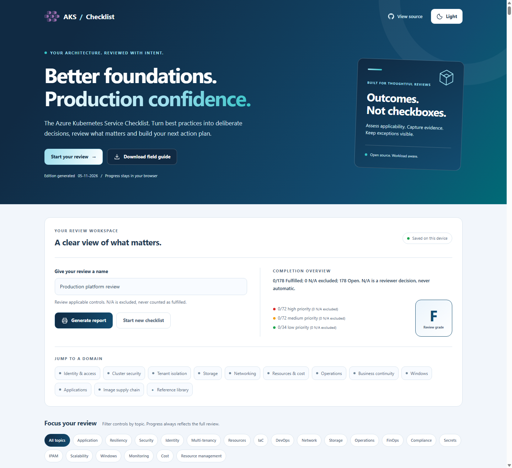
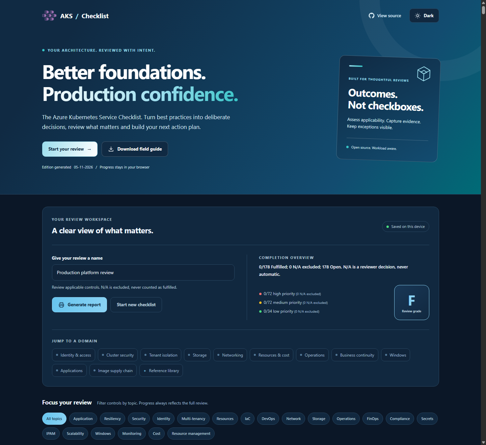
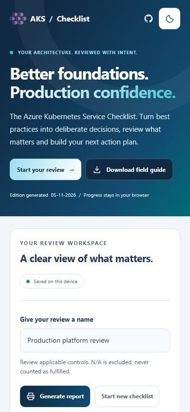

# The Azure Kubernetes Service Checklist

**Better foundations. Production confidence.**

An evidence-led architecture review for Azure Kubernetes Service (AKS).
Assess the decisions that matter, identify gaps and plan improvements across
**178 review controls**, **11 architecture domains** and **2 unscored references**.

[Open the checklist](https://aka.ms/the-aks-checklist) |
[Download the PDF field guide](src/web/docs/AKS-Checklist.pdf) |
[Azure Review Checklists JSON](src/web/fta/aks_checklist.en.json) |
[Local setup](#develop-and-publish-locally) |
[Contribute](#contributing)

[](LICENSE)

## Preview



The website and field guide share a deep navy, blue and cyan design.
The sun/moon button switches between light and dark mode; layouts adapt to
desktop, tablet and mobile screens.

<details>
<summary>View dark mode and the mobile layout</summary>

**Dark mode**



**Mobile layout**



</details>

Screenshots show the generated website in this repository with an example
review name. The public deployment may lag the source.

## What this checklist is for

Use the checklist for production-readiness reviews, platform design discussions,
upgrade planning and recurring operational assessments. It draws on
[Microsoft's AKS best practices](https://learn.microsoft.com/azure/aks/best-practices)
and Kubernetes guidance. The
[AKS baseline reference implementation](https://github.com/mspnp/aks-secure-baseline)
provides a complementary deployment example.

This is an architecture review aid, **not a certification, an automated compliance
assessment or a guarantee of production readiness**. A high completion grade
does not prove a system is secure or resilient. Validate applicability, current
support, regional availability and runtime behavior for the workload.

The checklist evaluates outcomes rather than adoption of specific products.
GitOps, Azure Backup, ephemeral OS disks and specialist networking or compute
options are conditional choices, not universal requirements. Preview features
need an explicit risk decision before production use.

## Run a review

1. **Name the review.** Enter a project or platform name in the review workspace.
2. **Assess each control.** Read its guidance, applicability criteria, related
   controls and supporting documentation. Record evidence, owners and exceptions
   in your team's review record; the website does not provide an evidence editor.
3. **Choose the outcome.** Check a verified control as Fulfilled, leave a gap
   Open, or select **Mark N/A** when it does not apply.
4. **Focus the discussion.** Jump to an architecture domain or filter by topic.
   Filters change visibility, not the overall completion calculation.
5. **Share the outcome.** Select **Generate report** to open the browser's print
   dialog. Print or save a PDF of the current review, including controls hidden
   by filters. Reports use a light layout even when the screen is in dark mode.

| Outcome | Meaning | Completion calculation |
| --- | --- | --- |
| Open | Not yet verified, incomplete or requiring follow-up. | Included in the denominator. |
| Fulfilled | Reviewed and verified for this workload. | Included in the numerator and denominator. |
| N/A | Explicitly judged not applicable by the reviewer. | Excluded from both; never treated as Fulfilled. |

When every control is N/A, completion is **0/0**, not 100%. The reference
appendix is always unscored.

Progress and appearance are saved locally in the browser. No Azure subscription
or sign-in is required to use the checklist. Answers are not synchronized across
devices, browser profiles or website origins. See
[progress and recovery](#progress-and-recovery) before clearing browser data.

## Architecture domains

The English JSON files are the source of truth for every generated edition.

| Domain | Review focus | Source |
| --- | --- | --- |
| Identity and authorization | API authentication, authorization, managed identities and workload identity. | [identity.json](data/en/items/identity.json) |
| Cluster security | Cluster hardening, policy, admission controls, secrets and threat protection. | [cluster_security.json](data/en/items/cluster_security.json) |
| Multi-tenancy and isolation | Tenant boundaries, namespaces, network isolation and workload separation. | [cluster_multi.json](data/en/items/cluster_multi.json) |
| Storage | Persistent volumes, CSI drivers, access patterns and data protection. | [storage.json](data/en/items/storage.json) |
| Networking | Address planning, connectivity, ingress, egress and network policy. | [networking.json](data/en/items/networking.json) |
| Resource management | Node pools, scheduling, scaling, capacity and cost decisions. | [resource_management.json](data/en/items/resource_management.json) |
| Cluster operations | Lifecycle management, upgrades, observability and operational resilience. | [operations.json](data/en/items/operations.json) |
| Business continuity and disaster recovery | Availability, backups, restore validation and recovery objectives. | [bc_dr.json](data/en/items/bc_dr.json) |
| Windows | Supported Windows node configurations and platform-specific constraints. | [windows.json](data/en/items/windows.json) |
| Application deployment | Workload health, deployment safety, resource settings and release practices. | [application.json](data/en/items/application.json) |
| Image management | Registry access, image hygiene, scanning and supply-chain controls. | [container.json](data/en/items/container.json) |

Related controls link across domains instead of repeating the same requirement.
Distinct activities such as build scanning, continuous reassessment, admission
enforcement and runtime detection remain separate review outcomes.

## Content currency and lifecycle guidance

The current English content was reviewed against Microsoft Learn and Kubernetes
documentation on **4 November 2026**. Each control links to its supporting
sources. Recheck those sources before implementation; this repository is not a
live support matrix.

Important findings from that review include:

| Area | Lifecycle finding and action |
| --- | --- |
| Node operating systems | Azure Linux 2.0 security updates ended on 30 November 2025; image removal began on 31 October 2026. Migrate remaining pools to a supported OS and test node replacement. |
| Windows | Windows Server 2019 support ended on 1 March 2026; Windows Network Policy Manager support ended on 30 September 2026. Validate the replacement OS and policy engine together. |
| Ingress | Upstream ingress-nginx maintenance ended in March 2026. Microsoft's application-routing NGINX security patch support runs through November 2026; assess a supported Gateway API implementation and test migration. |
| Networking and identity | Basic Load Balancer and the Pod Identity managed add-on are no longer supported. Use Standard Load Balancer and Microsoft Entra Workload ID. Plan kubenet migration before its 31 March 2028 retirement. |
| Logging | ContainerLog support retired on 30 September 2026. Migrate queries, alerts, workbooks and exports to ContainerLogV2, not just the collector configuration. |

Retirement notices and migration documentation are linked in the corresponding
source controls. Conflicting or incomplete Windows support documentation is
called out explicitly rather than resolved by assuming support.

Configuration flags alone do not prove effective enforcement or application
resilience. The checklist also calls for evidence of TLS certificate renewal,
admission-webhook resilience, fault injection under load and parallel-cluster
migration when in-place upgrades cannot meet risk requirements. Zone redundancy
and geo-replication do not replace tested backups and restores.

## Editions and repository layout

| Edition or component | Location | Purpose |
| --- | --- | --- |
| Interactive website | [src/web/index.html](src/web/index.html) | Review controls, save local progress, filter topics and print a review report. |
| PDF field guide | [src/web/docs/AKS-Checklist.pdf](src/web/docs/AKS-Checklist.pdf) | Read the reference checklist with a cover, contents, numbered controls and clickable resources. |
| Azure Review Checklists export | [src/web/fta/aks_checklist.en.json](src/web/fta/aks_checklist.en.json) | Import the active controls; unscored references are omitted. |
| Offline documents | `output/AKS-Checklist.md`, `output/AKS-Checklist.html`, `output/AKS-Checklist.docx` | Generate portable Markdown, self-contained HTML and optional editable Word editions locally. |
| Canonical content | [data/en/items/](data/en/items/) | Maintain the English checklist and its supporting metadata. |
| Historical identities | [data/en/legacy-index.json](data/en/legacy-index.json) | Preserve the frozen positional mapping used to migrate older browser progress. |
| Website template | [data/tooling/html-generator/template.html](data/tooling/html-generator/template.html) | Change the page structure before regenerating the website. |
| Website appearance and behavior | [src/web/styles/](src/web/styles/), [src/web/scripts/](src/web/scripts/) | Maintain responsive themes, review state and recovery behavior. |
| Validation and publishing | [data/scripts/](data/scripts/), [.github/workflows/](.github/workflows/) | Validate content, check links and generate or deploy the editions. |

The downloadable field guide contains reference content, not your saved answers.
Use **Generate report** on the website for a report of your current review.
The `output/` directory is ignored by Git; the PDF under `src/web/docs/` is
versioned.

## Develop and publish locally

Commands below are PowerShell examples run from the repository root.
Use the equivalent path separators on other platforms.

### Prerequisites

| Tool | Required for |
| --- | --- |
| Python 3.10+ | Source validation, document generation, the link audit and the local preview server. The Python publishing scripts use only the standard library. |
| A current Node.js LTS release | Review-state, theme and documentation-link tracking tests. |
| .NET 10 SDK | Generating the interactive website. |
| Chrome, Chromium or Microsoft Edge | Rendering the PDF field guide. |
| Pandoc | Generating the optional styled Word document. |

NuGet restore uses the Microsoft-protected source already configured in
[NuGet.Config](NuGet.Config). There is no npm or pip installation step for the
documented validation and publishing commands.

### Preview the website

The generated website is committed, so a local preview does not require a build:

```powershell
python -m http.server 8000 --bind 127.0.0.1 --directory src\web
```

Open `127.0.0.1:8000` in your browser and stop the server with `Ctrl+C`
when finished. Serve the site over HTTP rather than opening `index.html`
directly so browser storage and service-worker behavior have a consistent origin.

The theme follows the system appearance until you choose light or dark mode.
For visual checks, `?scoutTheme=light` and `?scoutTheme=dark` override the initial
appearance without replacing the saved preference.

### Validate the source and browser behavior

```powershell
python data\scripts\checklist.py
python -m unittest discover -s data\scripts -p "test_*.py"
node data\scripts\test_checklist_state.js
node data\scripts\test_theme.js
node data\scripts\test_link_tracking.js
```

Validation rejects malformed entries, duplicate or ambiguous identities,
invalid references, unsupported section names and unmapped historical controls.
The JavaScript tests cover progress migration, N/A scoring, scoped reset,
theme persistence and documentation URL tracking.

### Regenerate the website and reference editions

After changing canonical content, regenerate the JSON export, field guide and
website together:

```powershell
python data\scripts\transform_to_ft.py
python data\scripts\generate_offline.py --date 2026-11-04 --pdf src\web\docs\AKS-Checklist.pdf
dotnet run --project src\generator -- -f data\tooling\html-generator\template.html -p data\en\items -o src\web\index.html
node data\scripts\test_checklist_state.js src\web\index.html
```

The offline command also writes Markdown and self-contained HTML to `output/`.
To include the styled, editable Word edition, run:

```powershell
python data\scripts\generate_offline.py --date 2026-11-04 --pdf src\web\docs\AKS-Checklist.pdf --docx output\AKS-Checklist.docx
```

Use the actual content-review date for `--date`; omitting it uses today's date
and does not itself establish that the guidance has been reviewed.
Use `--output-dir` to choose another offline output directory, `--browser` to
select a Chromium-based executable and `--pandoc` to select a Pandoc executable.

The HTML, PDF and Word editions use the navy/blue publication design, with a
contents list, numbered controls, priority markers and applicability callouts.
PDF uses A4 pagination with running headers and page numbers. Word uses native
editable text, styles, bookmarks and clickable links. Generate Word through this
command rather than a plain Markdown-to-Word conversion, which omits that styling.
Generation replaces outputs rather than appending to them.

### Audit documentation links

```powershell
python data\scripts\check_links.py
```

The audit checks canonical content, README links and the website template.
It follows redirects, validates Microsoft Learn fragment targets and writes
`output/link-report.json`. Broken links, missing fragments and redirects needing
review are reported. Authentication blocks, rate limits and connection failures
remain **unverified**, not successful.

To retry unresolved or newly added URLs from an existing audit:

```powershell
python data\scripts\check_links.py --retry-report output\link-report.json
```

That retry reuses successful checks from the saved report. Run the full audit
without `--retry-report` when you need fresh results for every URL. A successful
HTTP response does not by itself prove a link is relevant to the recommendation.

## Progress and recovery

The website stores answers using stable control GUIDs. Older positional answers
are migrated through the frozen historical map, with a raw backup created first.
A consolidated control is automatically Fulfilled only when all predecessor
checks were Fulfilled. Partial or conflicting answers stay Open and require
review. Retired GUIDs remain represented by `supersedes` aliases.

| Storage key | Purpose |
| --- | --- |
| `aks-checklist:state:v2` | Current GUID-based answers and controls requiring migration review. |
| `aks-checklist:legacy-backup:v1` | Original data preserved before legacy migration. |
| `aks-checklist:reset-backup:<timestamp>` | Recovery copy created before a checklist reset. |
| `aks-checklist:theme:v1` | The separate light/dark preference. |

**Start new checklist** resets answers and review filters while retaining project
metadata, the theme preference, unrelated browser storage and recovery backups.
Backups are not automatically replayed after reset.

Unreadable data or denied storage produces a visible warning instead of silently
overwriting the original. When saving is unavailable, the current tab remains
usable but changes may be session-only. Inspect saved recovery data locally
without changing it:

```javascript
AksChecklistState.recovery()
```

This console helper is not a cross-device backup or a restore command.
Clearing site data, using another origin or switching browser profiles can make
saved answers unavailable. Avoid sharing private review details in public issues.

## Automation

| Workflow | Responsibility |
| --- | --- |
| [Validation build](.github/workflows/build.yml) | Validate pull requests targeting `staging` or `master`, run content and JavaScript tests, and build the website and PDF. |
| [GitHub Pages](.github/workflows/buildanddeploypages.yml) | Regenerate and deploy the website from `master`, or on manual dispatch. |
| [Production deployment](.github/workflows/buildanddeployprod.yml) | Build and publish the production Azure static website from `master`, or on manual dispatch. |
| [Staging deployment](.github/workflows/buildanddeploystaging.yml) | Build and publish the staging Azure static website from `staging`, or on manual dispatch. |
| [Offline editions](.github/workflows/generate-offline.yml) | Generate Markdown, HTML, PDF and Word editions and publish the configured offline resources. |
| [Documentation link audit](.github/workflows/check-links.yml) | Run the weekly/manual online audit and retain the detailed report as an artifact. |

Deployment workflows require the repository's configured Pages environment or
Azure credentials. A local build or a push to a feature branch does not deploy
the public website. Forks need their own deployment configuration; do not copy
credentials into source files.

## Contributing

Fork the project, make focused changes and open an upstream pull request against
**`staging`**. Keep the guidance broadly useful while making workload-specific
requirements explicit.

- Edit the appropriate English file under `data/en/items/`. Preserve the existing
  section order and each existing control's GUID; assign a new UUID to a new control.
- Include authoritative HTTPS documentation. Use `detail`, not `details`, for
  extended guidance and `applicability` for conditional scenarios.
- Use `related` for links to active control GUIDs. Use `kind: "reference"` for
  supporting material that must not affect completion or carry score values.
- Consolidate repeated controls into a canonical home, preserving unique guidance.
  Add every retired GUID to `supersedes`, including aliases inherited from earlier
  consolidations. Never regenerate or reorder `data/en/legacy-index.json`.
- Change website structure in the HTML template and behavior or appearance in
  the dedicated scripts and stylesheet, not only in generated `index.html`.
- Run the relevant validation commands, regenerate affected editions and review
  both light and dark layouts when changing the website.

Automated and AI-assisted maintenance supports the project; source verification
and human architectural judgment remain necessary.

## Credits and license

Created by [Louis-Guillaume MORAND](https://github.com/lgmorand), with contributions
from [Fernando Mejía](https://github.com/feranto),
[Michael Withrow](https://github.com/miwithro),
[Tommy Falgout](https://github.com/lastcoolnameleft) and the community.

The original website is adapted from the
[Front-End Checklist](https://github.com/thedaviddias/Front-End-Checklist) by
[David Dias](https://github.com/thedaviddias).
Icons by Freepik from [Flaticon](https://www.flaticon.com) are attributed under
[CC BY 3.0](https://creativecommons.org/licenses/by/3.0/).

The project is licensed under the [Mozilla Public License 2.0](LICENSE).
