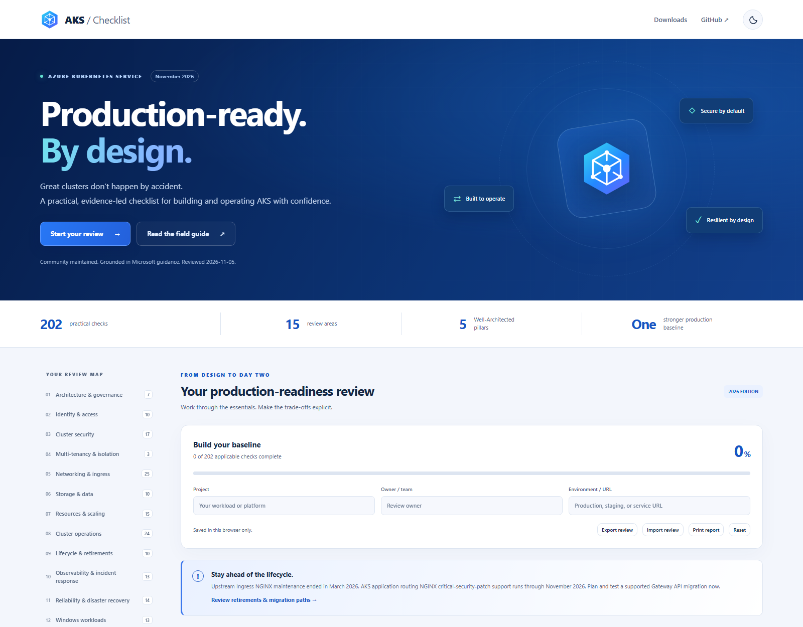
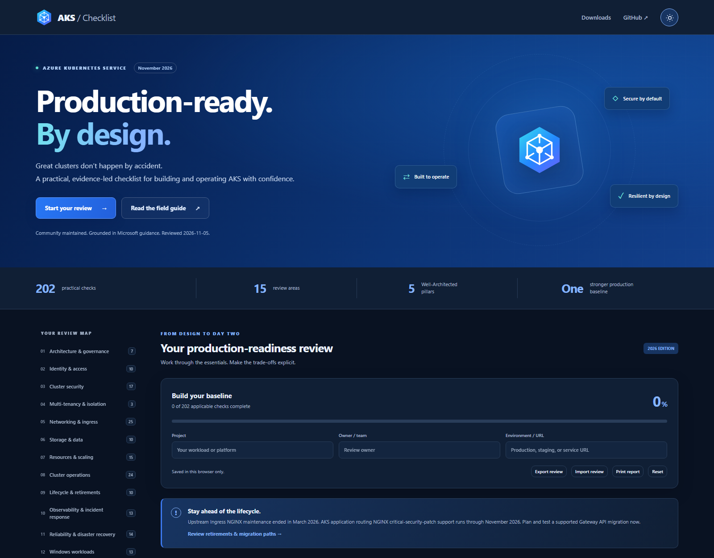

# The AKS Checklist

**Build with confidence. Operate with evidence.**

[](https://github.com/lgmorand/the-aks-checklist/actions/workflows/build.yml)
[](LICENSE)

An independent, community-maintained production-readiness review for **Azure Kubernetes Service**. The November 2026 edition contains **202 checks across 15 review areas**, grounded in Microsoft documentation and upstream Kubernetes guidance.

**[Open the live checklist](https://lgmorand.github.io/the-aks-checklist/)** · [PDF field guide](src/web/docs/AKS-Checklist.pdf) · [Editable Word guide](output/AKS-Checklist.docx) · [Standalone HTML](output/AKS-Checklist.html)



<details>
<summary>Explore the dark theme</summary>



</details>

## What this project does

Use the checklist with platform engineers, application owners, cloud architects, and operations teams to identify gaps before production and during ongoing reviews.

- Search guidance and combine priority, tag, and review-status filters.
- Track completed and not-applicable checks; capture evidence, exceptions, and action owners.
- Record the project, review owner, and environment.
- Save progress locally in your browser; export and import a portable JSON review.
- Print a complete review report, including guidance and evidence, independently of active screen filters.
- Switch between light and dark themes with an accessible sun/moon control. The system preference is used until you choose a theme.
- Read the same guidance in professionally styled HTML, tagged PDF with bookmarks, and an editable Word document with headings, navigation, and review fields.
- Download [Azure Review Checklist-compatible JSON](src/web/fta/aks_checklist.en.json).

**Context matters.** Completion is not a security certification, compliance attestation, or application SLA. Identify applicable checks, verify the linked support terms, and record accepted risks. AKS Automatic and Standard have different configuration responsibilities; validate the service-managed defaults as well as workload behavior.

### Review areas

| Platform design | Runtime and delivery | Day-two readiness |
|---|---|---|
| Architecture & governance | Cluster security | Cluster operations |
| Identity & access | Storage & data | Lifecycle & retirements |
| Multi-tenancy & isolation | Resources & scaling | Observability & incident response |
| Networking & ingress | Application delivery | Reliability & disaster recovery |
| Cost & sustainability | Images & supply chain | Windows workloads |

### Priorities

- **High:** foundational controls or time-sensitive lifecycle actions.
- **Medium:** important design and operational practices.
- **Low:** generally context-dependent optimizations or specialized capabilities.

These are review priorities, not vulnerability severities or an automated risk score. Not-applicable checks are excluded from the completion denominator. An entirely nonapplicable review is not shown as 100% complete.

## November 2026 content review

**Guidance reviewed: 5 November 2026.** This refresh audited the original 168 entries, added 36 checks, and removed a duplicate storage entry and the long-retired managed Kubernetes dashboard recommendation. Existing retained GUIDs are preserved.

The review corrected obsolete branding, unsupported recommendations, inaccurate Windows statements, copied descriptions, blanket networking defaults, misleading encryption and SLA claims, and inappropriate backup guidance. It adds architecture, lifecycle, observability, and cost sections and covers Gateway API migration, workload federation, CSI storage, Pod Security Standards, supply-chain provenance, maintenance, recovery testing, and evidence-based exceptions.

### Lifecycle actions to prioritize

Dates below are documented Microsoft timelines, not a promise of availability in every region or cloud. Follow the source documentation for the current migration procedure and support matrix.

| Area | Documented lifecycle / action | Primary source |
|---|---|---|
| Ingress NGINX | Upstream maintenance ended March 2026. AKS application routing NGINX critical-security-patch support runs through November 2026. Test and cut over to a supported Gateway API implementation. | [AKS ingress migration](https://learn.microsoft.com/en-us/azure/aks/app-routing-nginx-to-gateway-api-migration) |
| Azure Linux 2.0 | Support ended 30 November 2025; node-image removal began 31 March 2026. Use a supported OS and validate image/scale operations. | [Azure Linux AKS support cycle](https://learn.microsoft.com/en-us/azure/azure-linux/aks-support-cycle) |
| Pod-managed identity | Open-source project deprecated in 2022 and archived in 2023; AKS add-on patch support ended September 2025. Migrate to Microsoft Entra Workload ID. | [Workload ID migration](https://learn.microsoft.com/en-us/azure/aks/workload-identity-migrate-from-pod-identity) |
| Basic Load Balancer / Availability Sets | AKS support ended 30 September 2025. Follow the supported infrastructure migration paths. | [Basic Load Balancer upgrade](https://learn.microsoft.com/en-us/azure/aks/upgrade-basic-load-balancer-on-aks) |
| Windows Server 2019 | AKS support ended 1 March 2026; image removal is scheduled for 1 April 2027. | [Windows support and considerations](https://learn.microsoft.com/en-us/azure/aks/windows-vs-linux-containers) |
| Windows Annual Channel preview | Support ended 15 May 2026; image removal is scheduled for 15 May 2027. Migrate to supported LTSC images. | [Windows support and considerations](https://learn.microsoft.com/en-us/azure/aks/windows-vs-linux-containers) |
| Windows Azure NPM | AKS Windows support ended 30 September 2026. Validate a supported replacement policy engine. | [Network policy support](https://learn.microsoft.com/en-us/azure/aks/use-network-policies) |
| Kubenet | Retirement scheduled for 31 March 2028. Plan migration to Azure CNI Overlay. | [Legacy networking](https://learn.microsoft.com/en-us/azure/aks/concepts-network-legacy-cni) |
| Kubernetes versions | Use the regional release calendar rather than hard-coded “latest” versions. Microsoft documents platform-initiated upgrades starting 1 June 2027 after the unsupported-version grace period. | [AKS version policy](https://learn.microsoft.com/en-us/azure/aks/supported-kubernetes-versions) |

Other support-sensitive capabilities, such as the newer KMS data-encryption experience and IMDS restriction, are explicitly described as preview where Microsoft currently labels them that way; they are not recommended as unconditional production defaults.

### Architecture references

- [AKS best practices](https://learn.microsoft.com/en-us/azure/aks/best-practices)
- [AKS baseline architecture](https://learn.microsoft.com/en-us/azure/architecture/reference-architectures/containers/aks/baseline-aks)
- [AKS Automatic](https://learn.microsoft.com/en-us/azure/aks/intro-aks-automatic)
- [AKS support policies](https://learn.microsoft.com/en-us/azure/aks/support-policies)
- [ACR integration, including ABAC limitations](https://learn.microsoft.com/en-us/azure/aks/cluster-container-registry-integration)
- [Gateway API application routing](https://learn.microsoft.com/en-us/azure/aks/app-routing-gateway-api)

## Run and build locally

### Prerequisites

- **Node.js 24 LTS or later** and npm.
- Chromium installed through Playwright for PDF generation, screenshots, and browser validation.
- Internet access for the initial package/browser installation and the separate documentation-link audit.

There is no application framework, database, external font dependency, or client-side package bundle. The site uses semantic HTML, CSS, and native JavaScript modules. The single Node-based publishing pipeline replaces the previous separate .NET, Python/pandas, shell, Pandoc, and LaTeX generation paths.

```shell
npm ci
npx playwright install chromium
npm run documents
npm run preview
```

Open `http://127.0.0.1:4173`. Stop the preview with Ctrl+C. On Linux CI, use `npx playwright install --with-deps chromium` to install browser system dependencies as well.

| Command | Purpose |
|---|---|
| `npm run build` | Validate the catalogue and generate the website, FTA JSON, standalone HTML, and source manifest. Does not regenerate PDF or Word. |
| `npm run documents` | Rebuild the website and standalone HTML, generate Word and tagged PDF, and copy all three guides into the deployable site. |
| `npm test` | Validate data, uniqueness, escaping, output coverage, FTA compatibility, review-state rules, and legacy-progress mapping. |
| `npm run test:documents` | Verify A4 PDF pages, extracted titles, tagging/bookmarks, Word package styles/bookmarks/hyperlinks, and byte-identical published copies. Run after `documents`. |
| `npm run test:ui` | Exercise filters, state persistence, migration, themes, evidence, import/export, print behavior, downloads, responsive layouts, and no-JavaScript rendering. Run after `documents`. |
| `npm run check:links` | Audit unique source/README URLs with GET requests, redirects, retries, authentication-redirect detection, and HTML fragment checks. |
| `npm run screenshot` | Capture fresh light/dark README screenshots from the actual local site. Run after `build`. |
| `npm run preview` | Serve only the static website on loopback; missing resources return 404. |

The review date is explicit metadata, not the build date. A rebuild does not claim the content was researched again.

### Generated deliverables

| Deliverable | Location |
|---|---|
| Website | [src/web/index.html](src/web/index.html) |
| Standalone, self-contained HTML | [output/AKS-Checklist.html](output/AKS-Checklist.html) |
| Editable Word field guide | [output/AKS-Checklist.docx](output/AKS-Checklist.docx) |
| Tagged PDF field guide | [output/AKS-Checklist.pdf](output/AKS-Checklist.pdf) |
| Downloadable copies for the website | [src/web/docs/](src/web/docs/) |
| Azure Review Checklist data | [src/web/fta/aks_checklist.en.json](src/web/fta/aks_checklist.en.json) |
| Content date, counts, and source SHA-256 | [output/build-manifest.json](output/build-manifest.json) |
| Latest link-audit evidence | [output/link-audit.json](output/link-audit.json) |

PDF and HTML are reading guides; Word includes editable review fields. The website's **Print report** action includes local review metadata and evidence. Downloaded static guides do not contain your browser's assessment.

## Link quality and validation

Every retained recommendation has at least one documentation reference. This refresh checks actual HTTP responses, replaces broken/private-preview links, repairs moved articles, and removes stale anchors rather than treating a redirect or login page as sufficient evidence.

`npm run check:links` writes a timestamped JSON report. A failure, timeout, rate limit, or access block is reported explicitly and exits nonzero; an inaccessible site is not silently declared healthy. Fragment checks apply to static HTML; dynamic GitHub/YouTube fragments are not asserted. An HTTP success establishes reachability, not perpetual correctness, so semantic relevance is also reviewed during content maintenance.

Validation evidence for this refresh:

| Exact command | Result |
|---|---|
| `npm test` | Passed: 9 source, generation, and review-state regression tests. |
| `npm run documents` | Passed: HTML, Word, PDF, FTA data, and site generated successfully. |
| `npm run test:documents` | Passed: complete check-title coverage, tagged A4 PDF, bookmarks, nonblank pages, Word styles/hyperlinks, and identical published copies. |
| `npm run test:ui` | Passed: themes, saved state, migration, filters, import/export, print, responsive layouts, downloads, and no-JavaScript guidance. |
| `npm run check:links` | Passed: 198 unique URLs; 0 failed and 0 blocked. See the timestamped audit report. |
| `npm audit` | Passed: no known dependency vulnerabilities reported. |

Run these commands after changes; the committed link-audit and build manifests record the source snapshot and link-check time. The README screenshots are generated by `npm run screenshot`, not mockups.

## Project structure and maintenance

```text
data/en/items/                 Canonical English recommendations, grouped by area
data/en/project/catalog.json  Review date, sections, summaries, FTA mapping, notices
data/en/project/legacy-progress.json
                              Frozen original index-to-GUID migration map
data/tooling/html-generator/template.html
                              Editable website shell
scripts/                      Shared validation, build, documents, preview, and tests
src/web/styles/               Website and standalone-guide design systems
src/web/scripts/              Theme, review state, and browser interactions
src/web/docs/                 Published offline documents
test/                         Data, generation, and review-state regression tests
output/                       Generated guides and audit evidence
```

### Change content

1. Edit the appropriate English JSON file. Keep an existing entry's GUID when correcting or expanding it.
2. Provide `title`, `description`, `priority` (`High`, `Medium`, `Low`), a unique GUID, `tags` including `all`, and at least one titled HTTPS `documentation` link. Optional fields include `detail`, `tools`, and the existing FTA scoring metadata.
3. Use current product names and supported guidance. Avoid unqualified “always” recommendations, hard-coded latest versions, and preview features presented as general production requirements.
4. To add a section, register its file, title, summary, and FTA category in the catalogue. The website, navigation, exports, and FTA output all discover sections there.
5. Update the reviewed date only after revalidating the guidance. Check retirement announcements and API/add-on/OS support independently of Kubernetes LTS.
6. Run the validation commands above and regenerate documents. Refresh screenshots for visible design changes.

Legacy progress used positional IDs within categories. The new review uses stable GUIDs and migrates known old checks on first visit, including checks moved to new sections. Deleted items are not carried forward. The original storage keys are not deleted. Re-verify migrated completion against the updated recommendation text.

### Privacy and accessibility

Review data is stored in this browser's local storage, not sent to a service. Exported evidence can contain sensitive project information: handle the JSON and printed reports accordingly. There is no analytics script, external font request, or third-party favicon lookup. External documentation opens only when followed.

The site includes a skip link, semantic headings, visible keyboard focus, labeled inputs and progress, native disclosure controls, reduced-motion support, responsive layouts, and light/dark themes. Static content and links remain available without JavaScript; saved review features require it. Automated checks supplement rather than replace assistive-technology and manual accessibility testing.

## Automation and deployment

Pull requests run the shared [build and validation action](.github/actions/build-checklist/action.yml). GitHub Pages, production Azure Storage, and staging Azure Storage use the same validated site bundle, including all offline formats. The manual offline workflow publishes the three guides as artifacts. The weekly/manual link-audit workflow publishes its JSON report and fails on unresolved checks.

Existing Azure Storage deployments still use repository variables `CLIENT_ID`, `TENANT_ID`, and `SUBSCRIPTION_ID`, plus the `SECRET_ID` secret. Secret values are passed through environment variables rather than interpolated into shell commands. Configure least-privilege storage permissions and rotate that credential; moving to OIDC requires a federated identity to be provisioned first and is not assumed by this change.

The optional `_headers` file is for hosts that support that convention. GitHub Pages and Azure Storage do not automatically apply it; configure equivalent security headers at the CDN/edge if required. The former service worker is retired to avoid stale content. Use the standalone guides for offline reading.

This repository update does not itself deploy or change any Azure infrastructure.

## Contributing

Fork [the repository](https://github.com/lgmorand/the-aks-checklist), create a focused branch, and open a pull request **against `staging`**, following the [pull request template](.github/PULL_REQUEST_TEMPLATE.md). English JSON is the canonical source. Include first-party documentation for new recommendations and report the exact validation commands and results.

Prioritize common production scenarios while making specialized requirements conditional. Do not add credentials, private customer details, or unverifiable automated compliance claims.

## Credits and license

Created by **[Louis-Guillaume Morand](https://github.com/lgmorand)**.

Thanks to **[Fernando Mejía](https://github.com/feranto)**, **[Michael Withrow](https://github.com/miwithro)**, **[Tommy Falgout](https://github.com/lastcoolnameleft)**, and all contributors.

The original application was adapted from [David Dias's Front-End Checklist](https://github.com/thedaviddias/Front-End-Checklist). Retained legacy artwork includes Freepik/Flaticon assets under their original CC BY attribution. The refreshed geometric AKS Checklist mark is project artwork, not a Microsoft product logo.

Licensed under the [Mozilla Public License 2.0](LICENSE).
